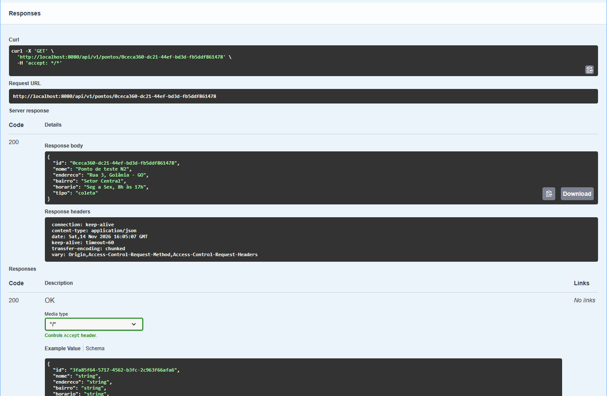
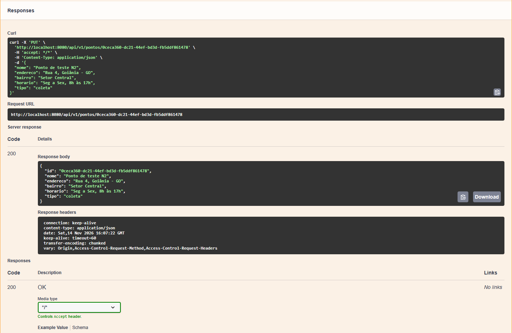
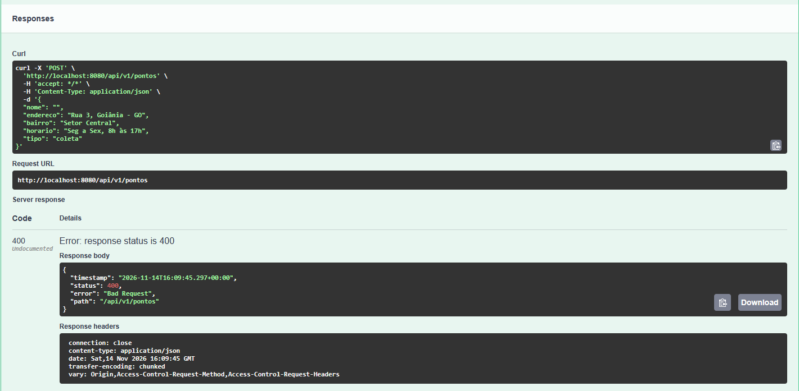
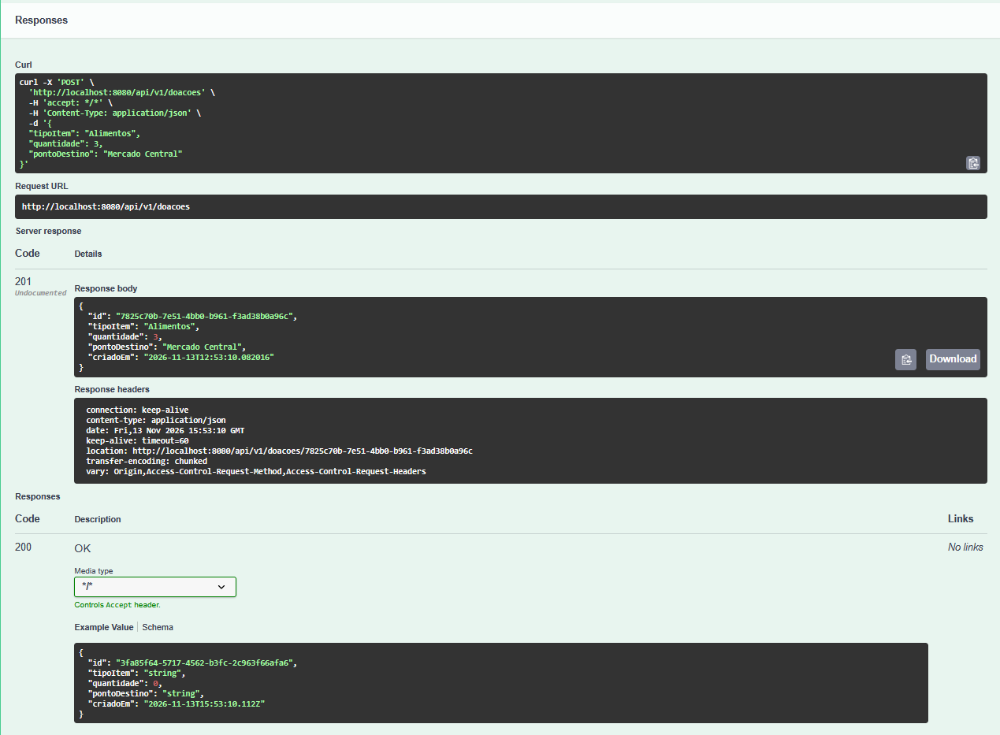
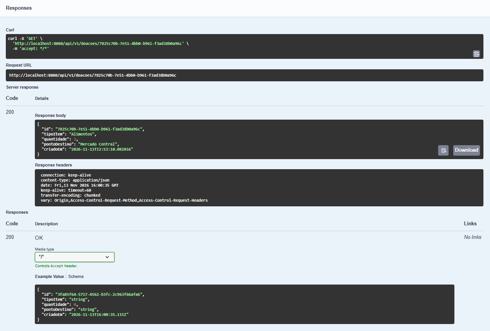
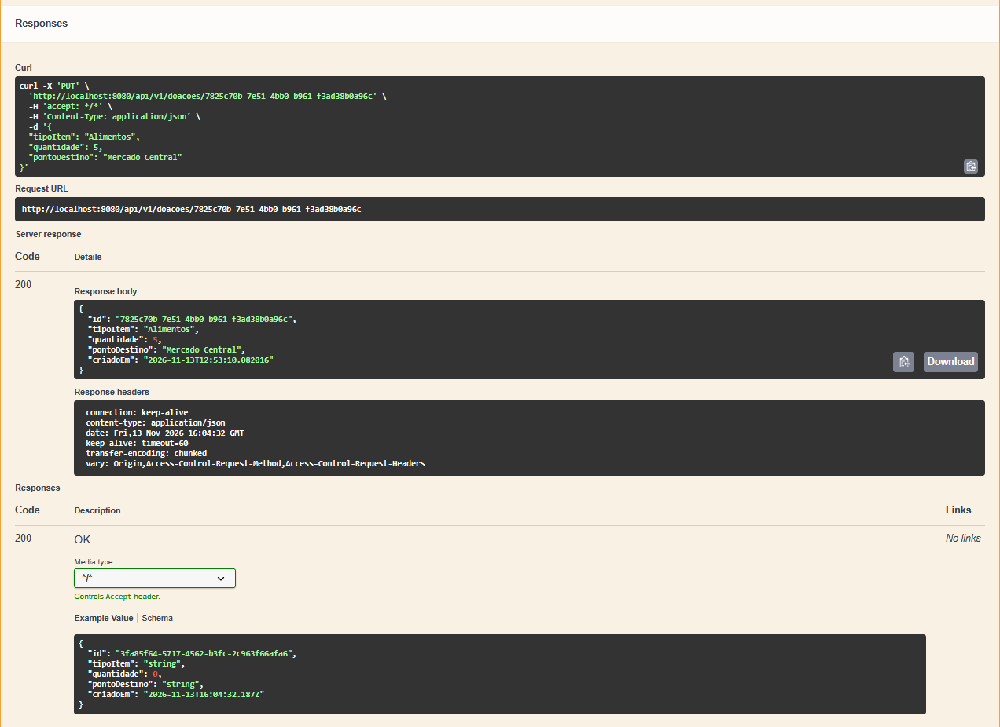
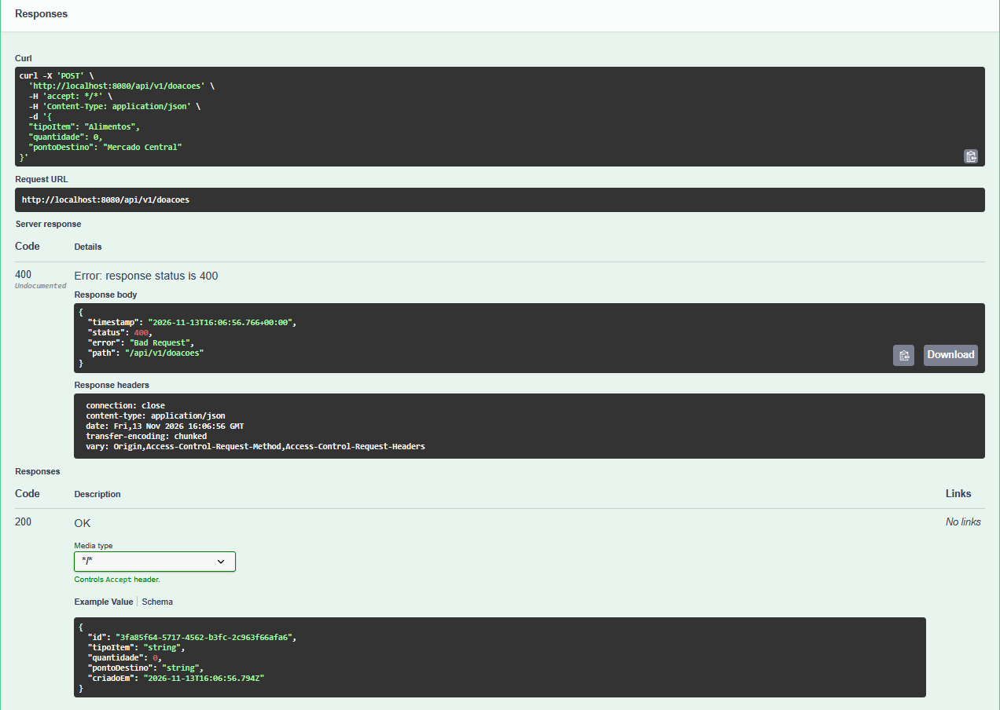

# Instituto Mão Amiga

Aplicativo Expo, React Native e TypeScript, com API Spring Boot e banco H2 em
arquivo. Estado atual: **N2-7 — edição e exclusão de doações pela API (#22)**.

## Executar

Requisitos: JDK 21, Node.js compatível com o Expo 57 e npm. O Maven Wrapper
baixa o Maven e as dependências no primeiro uso.

Em um terminal, na pasta `api/`:

```bat
mvnw.cmd spring-boot:run
```

Linux/macOS: `bash mvnw spring-boot:run`.
Use uma única instância da API. Se iniciou com `spring-boot:start`, use
`mvnw.cmd spring-boot:stop` antes de iniciar outra.

Na raiz, em outro terminal:

```bat
npm ci
npx expo start --web --clear
```

Para Expo Go: `npm start`. Ajuste apenas `src/services/api.ts`:

| Ambiente | API_URL |
|---|---|
| Web no computador / simulador iOS | `http://localhost:8080/api/v1` |
| Android Emulator | `http://10.0.2.2:8080/api/v1` |
| Celular físico na mesma rede | `http://IP_DO_COMPUTADOR:8080/api/v1` |

Swagger: http://localhost:8080/swagger-ui/index.html

OpenAPI: http://localhost:8080/v3/api-docs

O banco fica em `api/data/maoamiga.mv.db` quando a API é iniciada em `api/`.
Não apague `api/data/`. A carga versionada insere 25 pontos demonstrativos de
Goiânia sem duplicar a cada reinício. Não representam postos reais confirmados.

## Funcionalidades

- Pontos: lista paginada, busca por nome/bairro, detalhe, cadastro, edição e exclusão.
- Doações: cadastro, histórico paginado, filtro por tipo, detalhe por UUID,
  edição no mesmo formulário e exclusão com confirmação.
- O destino é escolhido entre pontos da API; a doação armazena seu nome.
- Edição envia PUT sem ID/data no corpo; o servidor preserva UUID e criadoEm.
- Detalhe e histórico recarregam ao receber foco, refletindo alterações e exclusões.
- Falhas mostram aviso e preservam os dados digitados. A navegação ocorre depois
  da resposta de sucesso e da confirmação do aviso.
- Android/iOS usam Alert.alert; web usa os diálogos da aplicação, com Cancelar/Excluir.

Doações antigas no aparelho não são migradas nem apagadas; o app usa a API.
Favoritos locais são a próxima etapa, N2-8 (#23), ainda não implementada.

## Endpoints

Base: `http://localhost:8080`. UUID inexistente em GET/PUT/DELETE retorna 404;
dados inválidos retornam 400. DELETE bem-sucedido retorna 204, sem corpo.

| Método | URL | Sucesso |
|---|---|---|
| GET | `/api/v1/pontos` | 200, lista completa |
| GET | `/api/v1/pontos/filtro?filtro=Central&page=0&size=10` | 200, content/page |
| GET | `/api/v1/pontos/{id}` | 200 |
| POST | `/api/v1/pontos` | 201 |
| PUT | `/api/v1/pontos/{id}` | 200 |
| DELETE | `/api/v1/pontos/{id}` | 204 |
| GET | `/api/v1/doacoes/filtro?filtro=roupa&page=0&size=10` | 200, content/page |
| GET | `/api/v1/doacoes/{id}` | 200 |
| POST | `/api/v1/doacoes` | 201 |
| PUT | `/api/v1/doacoes/{id}` | 200 |
| DELETE | `/api/v1/doacoes/{id}` | 204 |

Corpo de POST/PUT de ponto:

```json
{"nome":"Ponto de teste","endereco":"Rua 3, Goiânia - GO","bairro":"Setor Central","horario":"8h às 17h","tipo":"coleta"}
```

Corpo de POST/PUT de doação:

```json
{"tipoItem":"Alimentos","quantidade":3,"pontoDestino":"Ponto de teste"}
```

No Swagger, o campo pageable pode ser preenchido com `{"page":0,"size":10}`.
Omitir sort usa a ordenação padrão: nome crescente para pontos, criadoEm
decrescente para doações. Evite enviar aspas/colchetes como texto no parâmetro
sort da URL. O app envia parâmetros de ordenação separados corretamente.

## Testes

Na raiz: `npm run typecheck` e `npm test`. Na pasta api: `mvnw.cmd test`
(ou `bash mvnw test`). Os testes de backend usam H2 isolado em memória.

Veja [validação N2-7](docs/n2-7/VALIDACAO.md),
[roteiro de aceite](docs/n2-7/README.md) e
[roteiro de demonstração](ROTEIRO-DEMONSTRACAO.md).

## Evidências do Swagger — N2-1: pontos

Capturas reais enviadas pelo autor. Considere Server response, não Example Value.

### GET lista — 200


### POST — 201


### GET por UUID — 200



### PUT — 200



### DELETE — 204


### POST inválido — 400



### GET inexistente — 404


## Evidências do Swagger — N2-5: doações

### POST — 201



### GET paginado — 200


### GET por UUID — 200



### PUT — 200



### DELETE — 204


### POST inválido — 400



### GET inexistente — 404


A listagem de doações agora mostra 200, content vazio e metadados page. É uma
resposta válida de banco sem doações, não demonstra várias páginas ou filtro.

## Revisão das evidências

As capturas cobrem os endpoints de N2-1 e N2-5, incluindo um 400 e um 404 em
cada grupo. Não faltam imagens para essa cobertura mínima. Não localizamos
prints de PUT inválido (400) nem PUT de UUID inexistente (404) para pontos ou
doações; são evidências adicionais recomendadas para os critérios funcionais,
não uma nova exigência de print de cada combinação de método/status.
N2-7 não exige explicitamente prints; o roteiro manual documenta como validar.
Veja [auditoria de organização e evidências](docs/n2-7/AUDITORIA.md).

## Organização

- api/: controllers, DTOs, services, repositories, entidades e testes Java.
- src/services/api.ts: acesso HTTP centralizado e URL da API.
- src/services/: operações de pontos e doações na API.
- src/state/: controle de paginação e descarte de respostas antigas.
- src/screens/, components/, contexts/, navigation/, types/: interface e contratos.
- tests/: testes automatizados TypeScript/UI em Node e JSDOM.
- docs/: evidências reais e registros das etapas anteriores.

Documentação histórica: [N2-2](docs/n2-2/VALIDACAO.md),
[N2-3](docs/n2-3/README.md), [N2-4](docs/n2-4/README.md),
[N2-5](docs/n2-5/README.md), [N2-6](docs/n2-6/README.md).
