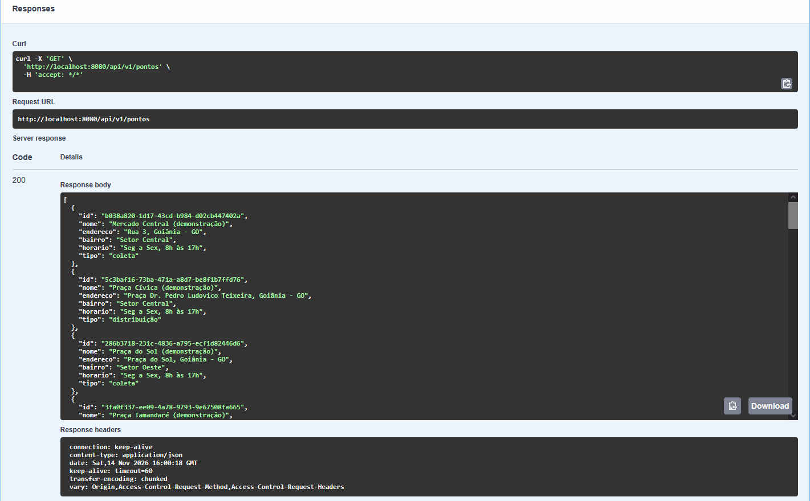
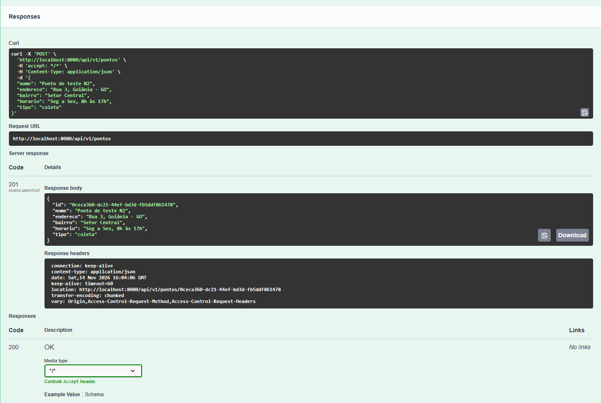
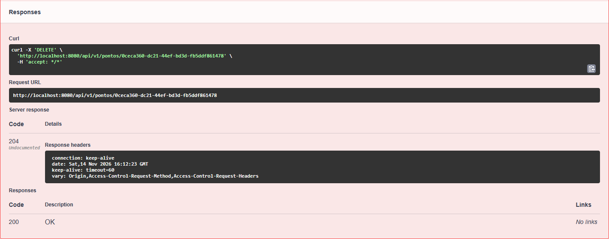
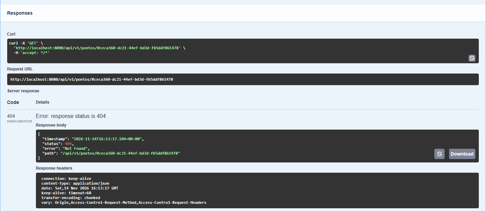
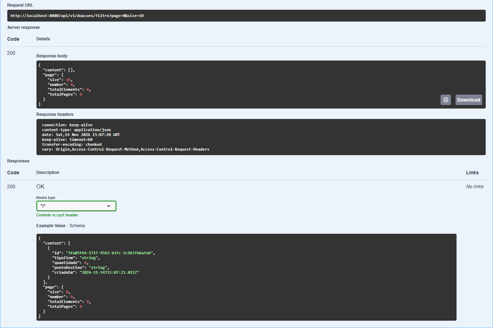
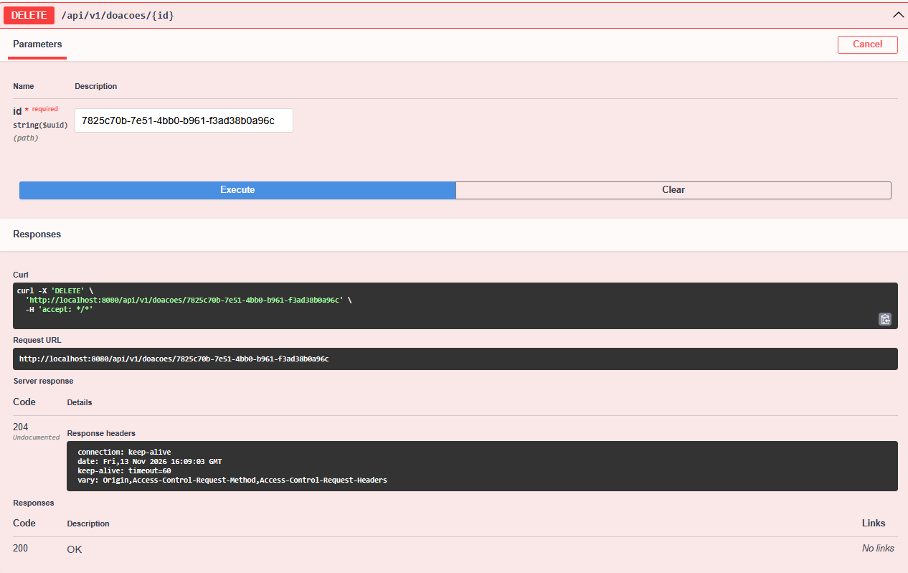
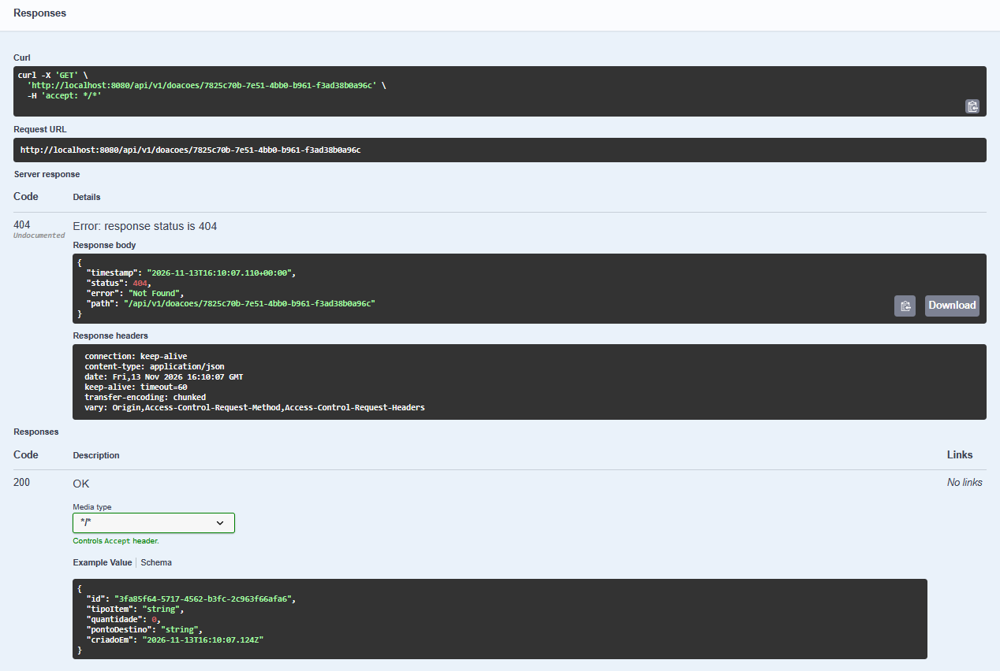

# Instituto Mão Amiga

Aplicativo Expo, React Native e TypeScript, com API Spring Boot e banco H2 em
arquivo. Estado atual: **N2-8 — favoritos e entrega final (#23)**.

## Executar

Requisitos: JDK 21, Node.js compatível com o Expo 57 e npm. O Maven Wrapper
baixa o Maven e as dependências no primeiro uso.

Em um terminal, na pasta `api/`:

```bat
mvnw.cmd spring-boot:run
```

Linux/macOS: `bash mvnw spring-boot:run`.
Use uma única instância da API. Se iniciou com `spring-boot:start`, use
`mvnw.cmd spring-boot:stop` antes de iniciar outra.

Na raiz, em outro terminal:

```bat
npm ci
npx expo start --web --clear
```

Para Expo Go: `npm start`. Ajuste apenas `src/services/api.ts`:

| Ambiente | API_URL |
|---|---|
| Web no computador / simulador iOS | `http://localhost:8080/api/v1` |
| Android Emulator | `http://10.0.2.2:8080/api/v1` |
| Celular físico na mesma rede | `http://IP_DO_COMPUTADOR:8080/api/v1` |

Swagger: http://localhost:8080/swagger-ui/index.html

OpenAPI: http://localhost:8080/v3/api-docs

O banco fica em `api/data/maoamiga.mv.db` quando a API é iniciada em `api/`.
Não apague `api/data/`. A carga versionada insere 25 pontos demonstrativos de
Goiânia sem duplicar a cada reinício. Não representam postos reais confirmados.

## Funcionalidades

- Pontos: lista paginada, busca por nome/bairro, detalhe, cadastro, edição e exclusão.
- Doações: cadastro, histórico paginado, filtro por tipo, detalhe por UUID,
  edição no mesmo formulário e exclusão com confirmação.
- O destino é escolhido entre pontos da API; a doação armazena seu nome.
- Edição envia PUT sem ID/data no corpo; o servidor preserva UUID e criadoEm.
- Detalhe e histórico recarregam ao receber foco, refletindo alterações e exclusões.
- Falhas mostram aviso e preservam os dados digitados. A navegação ocorre depois
  da resposta de sucesso e da confirmação do aviso.
- Android/iOS usam Alert.alert; web usa os diálogos da aplicação, com Cancelar/Excluir.

Doações antigas no aparelho não são migradas nem apagadas; o app usa a API.
Favoritos ficam no AsyncStorage, somente como UUIDs. O botão ♡/♥ tem área mínima
44×44. A tela Meus pontos consulta cada UUID na API, ignora pontos excluídos
(404) e permite desmarcar. Falhas de conexão mostram erro com nova tentativa.

Decisão técnica: pontos/doações são dados compartilhados e persistem na API;
favoritos são uma preferência deste aparelho/navegador. Salvar só IDs evita
mostrar uma cópia desatualizada do nome/endereço do ponto. Na web, mantenha a
mesma origem (protocolo, host e porta) para usar o mesmo armazenamento local.

## Endpoints

Base: `http://localhost:8080`. UUID inexistente em GET/PUT/DELETE retorna 404;
dados inválidos retornam 400. DELETE bem-sucedido retorna 204, sem corpo.

| Método | URL | Sucesso |
|---|---|---|
| GET | `/api/v1/pontos` | 200, lista completa |
| GET | `/api/v1/pontos/filtro?filtro=Central&page=0&size=10` | 200, content/page |
| GET | `/api/v1/pontos/{id}` | 200 |
| POST | `/api/v1/pontos` | 201 |
| PUT | `/api/v1/pontos/{id}` | 200 |
| DELETE | `/api/v1/pontos/{id}` | 204 |
| GET | `/api/v1/doacoes/filtro?filtro=roupa&page=0&size=10` | 200, content/page |
| GET | `/api/v1/doacoes/{id}` | 200 |
| POST | `/api/v1/doacoes` | 201 |
| PUT | `/api/v1/doacoes/{id}` | 200 |
| DELETE | `/api/v1/doacoes/{id}` | 204 |

Corpo de POST/PUT de ponto:

```json
{"nome":"Ponto de teste","endereco":"Rua 3, Goiânia - GO","bairro":"Setor Central","horario":"8h às 17h","tipo":"coleta"}
```

Corpo de POST/PUT de doação:

```json
{"tipoItem":"Alimentos","quantidade":3,"pontoDestino":"Ponto de teste"}
```

No Swagger, o campo pageable pode ser preenchido com `{"page":0,"size":10}`.
Omitir sort usa a ordenação padrão: nome crescente para pontos, criadoEm
decrescente para doações. Evite enviar aspas/colchetes como texto no parâmetro
sort da URL. O app envia parâmetros de ordenação separados corretamente.

## Testes

Na raiz: `npm run typecheck` e `npm test`. Na pasta api: `mvnw.cmd test`
(ou `bash mvnw test`). Os testes de backend usam H2 isolado em memória.

Os testes de interface usam React Native Web em JSDOM, com HTTP simulado.
A validação visual no navegador/celular não está registrada neste repositório.

## N2-2 — três chamadas e respostas

Exemplos reais já registrados pelos testes de integração com H2 isolado.
UUIDs e totais podem mudar no seu banco. size=1 deixa cada exemplo compacto;
o padrão sem size permanece 10.

### Sem filtro

GET `http://localhost:8080/api/v1/pontos/filtro?size=1` — 200.

```json
{
  "content" : [ {
    "id" : "9501a4f5-4a89-4227-9843-fda6549d5255",
    "nome" : "Campinas (demonstração)",
    "endereco" : "Av. 24 de Outubro, Goiânia - GO",
    "bairro" : "Campinas",
    "horario" : "Seg a Sex, 8h às 17h",
    "tipo" : "distribuição"
  } ],
  "page" : {
    "size" : 1,
    "number" : 0,
    "totalElements" : 25,
    "totalPages" : 25
  }
}
```

### Por bairro

GET `http://localhost:8080/api/v1/pontos/filtro?filtro=Setor%20Central&size=1` — 200.

```json
{
  "content" : [ {
    "id" : "162d623a-e04f-4b13-850e-30b95022a026",
    "nome" : "Mercado Central (demonstração)",
    "endereco" : "Rua 3, Goiânia - GO",
    "bairro" : "Setor Central",
    "horario" : "Seg a Sex, 8h às 17h",
    "tipo" : "coleta"
  } ],
  "page" : {
    "size" : 1,
    "number" : 0,
    "totalElements" : 2,
    "totalPages" : 2
  }
}
```

### Segunda página

GET `http://localhost:8080/api/v1/pontos/filtro?page=1&size=1` — 200.

```json
{
  "content" : [ {
    "id" : "162d623a-e04f-4b13-850e-30b95022a026",
    "nome" : "Mercado Central (demonstração)",
    "endereco" : "Rua 3, Goiânia - GO",
    "bairro" : "Setor Central",
    "horario" : "Seg a Sex, 8h às 17h",
    "tipo" : "coleta"
  } ],
  "page" : {
    "size" : 1,
    "number" : 1,
    "totalElements" : 25,
    "totalPages" : 25
  }
}
```

## Evidências do Swagger — N2-1: pontos

Respostas dos endpoints capturadas no Swagger.

### GET lista — 200



### POST — 201



### GET por UUID — 200


### PUT — 200


### DELETE — 204



### POST inválido — 400


### GET inexistente — 404



## Evidências do Swagger — N2-5: doações

### POST — 201


### GET paginado — 200



### GET por UUID — 200


### PUT — 200


### DELETE — 204



### POST inválido — 400


### GET inexistente — 404



A listagem de doações agora mostra 200, content vazio e metadados page. É uma
resposta válida de banco sem doações, não demonstra várias páginas ou filtro.

## Organização

- api/: controllers, DTOs, services, repositories, entidades e testes Java.
- src/services/api.ts: acesso HTTP centralizado e URL da API.
- src/services/: operações de pontos e doações na API.
- src/state/: controle de paginação e descarte de respostas antigas.
- src/screens/, components/, contexts/, navigation/, types/: interface e contratos.
- tests/: testes automatizados TypeScript/UI em Node e JSDOM.
- docs/: capturas do Swagger e exemplos de respostas da API.

## Demonstração final — até 3 minutos

| Tempo | Ação |
|---|---|
| 0:00–0:40 | Buscar ponto por bairro, cadastrar ponto de teste, editar e excluir |
| 0:40–1:00 | Favoritar outro ponto, abrir Meus pontos e mostrar o coração marcado |
| 1:00–1:50 | Cadastrar doação, abrir histórico/detalhe, editar quantidade e excluir com confirmação |
| 1:50–2:35 | Mostrar no Swagger POST inválido 400 e GET de UUID excluído 404 |
| 2:35–3:00 | Explicar favoritos locais por ID versus pontos/doações no servidor |

Deixe API e app ligados e o Swagger aberto antes de começar. Ensaie o tempo.
O [roteiro detalhado](ROTEIRO-DEMONSTRACAO.md) inclui preparação e explicação.
